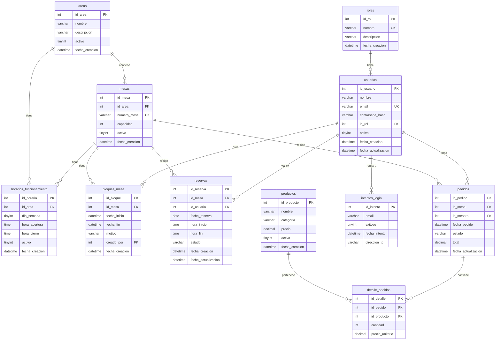

# 03. Base de datos — Sistema de gestion de un restaurante

> **Estado:** borrador de planificacion (etapa 1 - sin programar, sin ejecutar cambios en BD).  
> **Idioma:** espanol.  
> **Nombres:** espanol, snake_case para tablas y columnas.  
> **SGBD de referencia:** MariaDB 10.11 / MySQL 8.0 (compatible entre ambos).

---

## 1. Modelo de datos (entidades y tablas)

Se modela solo lo necesario para los requisitos confirmados del PDF (actividad 2) y la instruccion de planificacion. Incluye reservas de mesas y modulo de pedidos. No hay tablas redundantes ni datos derivados almacenados innecesariamente.

### Tabla: roles
Roles de usuario del sistema.

| Columna | Tipo | Nulo | Clave | Descripcion |
|---------|------|------|-------|-------------|
| id_rol | INT | NO | PK | Identificador del rol |
| nombre | VARCHAR(50) | NO | UNIQUE | Nombre del rol (cliente, mesero, cocinero, administrador) |
| descripcion | VARCHAR(200) | SI | | Descripcion del rol |
| fecha_creacion | DATETIME | NO | | Fecha de creacion del registro (auditoria) |

### Tabla: usuarios
Usuarios del sistema (clientes, meseros, cocineros, administradores).

| Columna | Tipo | Nulo | Clave | Descripcion |
|---------|------|------|-------|-------------|
| id_usuario | INT | NO | PK | Identificador del usuario |
| nombre | VARCHAR(100) | NO | | Nombre completo |
| email | VARCHAR(150) | NO | UNIQUE | Correo electronico (usuario de inicio de sesion) |
| contrasena_hash | VARCHAR(255) | NO | | Hash bcrypt de la contrasena |
| id_rol | INT | NO | FK | Rol del usuario (roles.id_rol) |
| activo | TINYINT(1) | NO | DEFAULT 1 | Indica si el usuario esta habilitado |
| fecha_creacion | DATETIME | NO | | Fecha de creacion (auditoria) |
| fecha_actualizacion | DATETIME | SI | | Fecha de ultima actualizacion (auditoria) |

### Tabla: areas
Areas o salones del restaurante (terraza, salon principal, VIP, etc.).

| Columna | Tipo | Nulo | Clave | Descripcion |
|---------|------|------|-------|-------------|
| id_area | INT | NO | PK | Identificador del area |
| nombre | VARCHAR(150) | NO | | Nombre del area (ej. Salon principal, Terraza) |
| descripcion | VARCHAR(255) | SI | | Descripcion del area |
| activo | TINYINT(1) | NO | DEFAULT 1 | Indica si esta disponible para reservas |
| fecha_creacion | DATETIME | NO | | Fecha de creacion (auditoria) |

### Tabla: mesas
Mesas dentro de un area.

| Columna | Tipo | Nulo | Clave | Descripcion |
|---------|------|------|-------|-------------|
| id_mesa | INT | NO | PK | Identificador de la mesa |
| id_area | INT | NO | FK | Area a la que pertenece (areas.id_area) |
| numero_mesa | VARCHAR(20) | NO | | Numero o identificador de la mesa (ej. M1, M5) |
| capacidad | INT | NO | DEFAULT 1 | Cantidad maxima de comensales |
| activo | TINYINT(1) | NO | DEFAULT 1 | Indica si esta disponible para reservas |
| fecha_creacion | DATETIME | NO | | Fecha de creacion (auditoria) |

### Tabla: horarios_funcionamiento
Horarios de apertura y cierre de cada area por dia de la semana.

| Columna | Tipo | Nulo | Clave | Descripcion |
|---------|------|------|-------|-------------|
| id_horario | INT | NO | PK | Identificador del horario |
| id_area | INT | NO | FK | Area (areas.id_area) |
| dia_semana | TINYINT(1) | NO | | Dia de la semana (0=domingo ... 6=sabado) |
| hora_apertura | TIME | NO | | Hora de apertura |
| hora_cierre | TIME | NO | | Hora de cierre |
| activo | TINYINT(1) | NO | DEFAULT 1 | Indica si el horario esta vigente |
| fecha_creacion | DATETIME | NO | | Fecha de creacion (auditoria) |

**Restriccion CHECK:** `hora_cierre > hora_apertura`.

### Tabla: bloques_mesa
Periodos en los que una mesa no esta disponible (mantenimiento, cerrado, evento privado). No son reservas de usuarios.

| Columna | Tipo | Nulo | Clave | Descripcion |
|---------|------|------|-------|-------------|
| id_bloque | INT | NO | PK | Identificador del bloque |
| id_mesa | INT | NO | FK | Mesa (mesas.id_mesa) |
| fecha_inicio | DATETIME | NO | | Fecha y hora de inicio del bloque |
| fecha_fin | DATETIME | NO | | Fecha y hora de fin del bloque |
| motivo | VARCHAR(200) | SI | | Motivo del bloqueo (ej. mantenimiento) |
| creado_por | INT | SI | FK | Usuario administrador que creo el bloque (usuarios.id_usuario) |
| fecha_creacion | DATETIME | NO | | Fecha de creacion (auditoria) |

**Regla:** `fecha_fin > fecha_inicio`.

### Tabla: reservas
Reservas de mesas realizadas por clientes.

| Columna | Tipo | Nulo | Clave | Descripcion |
|---------|------|------|-------|-------------|
| id_reserva | INT | NO | PK | Identificador de la reserva |
| id_mesa | INT | NO | FK | Mesa reservada (mesas.id_mesa) |
| id_usuario | INT | NO | FK | Usuario cliente que hace la reserva (usuarios.id_usuario) |
| fecha_reserva | DATE | NO | | Fecha de la reserva |
| hora_inicio | TIME | NO | | Hora de inicio del turno |
| hora_fin | TIME | NO | | Hora de fin del turno (hora_inicio + duracion) |
| estado | VARCHAR(20) | NO | DEFAULT pendiente | Estado: pendiente, confirmada, cancelada, vencida, completada |
| fecha_creacion | DATETIME | NO | | Fecha en que se creo la reserva (auditoria) |
| fecha_actualizacion | DATETIME | SI | | Fecha de ultima modificacion de estado (auditoria) |

**Restricciones:**
- `hora_fin > hora_inicio`.
- Estado en conjunto CHECK: `estado IN ('pendiente','confirmada','cancelada','vencida','completada')`.

### Tabla: productos
Productos del menu del restaurante.

| Columna | Tipo | Nulo | Clave | Descripcion |
|---------|------|------|-------|-------------|
| id_producto | INT | NO | PK | Identificador del producto |
| nombre | VARCHAR(150) | NO | | Nombre del producto (ej. Milanesa con papas) |
| categoria | VARCHAR(50) | SI | | Categoria (bebida, plato_principal, postre, etc.) |
| precio | DECIMAL(10,2) | NO | | Precio del producto |
| activo | TINYINT(1) | NO | DEFAULT 1 | Indica si esta disponible para pedidos |
| fecha_creacion | DATETIME | NO | | Fecha de creacion (auditoria) |

**Restriccion CHECK:** `precio >= 0`.

### Tabla: pedidos
Pedidos registrados por meseros, asociados a una mesa.

| Columna | Tipo | Nulo | Clave | Descripcion |
|---------|------|------|-------|-------------|
| id_pedido | INT | NO | PK | Identificador del pedido |
| id_mesa | INT | NO | FK | Mesa asociada (mesas.id_mesa) |
| id_mesero | INT | NO | FK | Mesero que tomo el pedido (usuarios.id_usuario) |
| fecha_pedido | DATETIME | NO | DEFAULT CURRENT_TIMESTAMP | Fecha y hora en que se registro el pedido |
| estado | VARCHAR(20) | NO | DEFAULT pendiente | Estado: pendiente, en_preparacion, listo, entregado, cancelado |
| total | DECIMAL(10,2) | NO | DEFAULT 0.00 | Total del pedido (suma de detalle) |
| fecha_actualizacion | DATETIME | SI | | Fecha de ultima modificacion de estado (auditoria) |

**Restricciones:**
- `total >= 0`.
- Estado CHECK: `estado IN ('pendiente','en_preparacion','listo','entregado','cancelado')`.

### Tabla: detalle_pedidos
Lineas de cada pedido (productos y cantidades).

| Columna | Tipo | Nulo | Clave | Descripcion |
|---------|------|------|-------|-------------|
| id_detalle | INT | NO | PK | Identificador del detalle |
| id_pedido | INT | NO | FK | Pedido al que pertenece (pedidos.id_pedido) |
| id_producto | INT | NO | FK | Producto solicitado (productos.id_producto) |
| cantidad | INT | NO | DEFAULT 1 | Cantidad solicitada |
| precio_unitario | DECIMAL(10,2) | NO | | Precio unitario al momento del pedido |

**Restricciones:**
- `cantidad >= 1`.
- `precio_unitario >= 0`.

### Tabla: intentos_login (auditoria de seguridad)
Registro de intentos de inicio de sesion para control de fuerza bruta.

| Columna | Tipo | Nulo | Clave | Descripcion |
|---------|------|------|-------|-------------|
| id_intento | INT | NO | PK | Identificador del intento |
| email | VARCHAR(150) | NO | | Email usado en el intento |
| exitoso | TINYINT(1) | NO | | Indica si el inicio de sesion fue exitoso |
| fecha_intento | DATETIME | NO | | Fecha y hora del intento |
| direccion_ip | VARCHAR(45) | SI | | Direccion IP del cliente (almacenable) |

---

## 2. Relaciones y cardinalidades

| Relacion | Cardinalidad | Descripcion |
|----------|--------------|-------------|
| roles <- usuarios | 1 : N | Un rol puede tener muchos usuarios; un usuario tiene un solo rol. |
| areas <- mesas | 1 : N | Un area tiene muchas mesas; una mesa pertenece a un area. |
| mesas <- horarios_funcionamiento | 1 : N | Una area tiene muchos horarios (uno por dia de semana). |
| mesas <- bloques_mesa | 1 : N | Una mesa puede tener muchos periodos bloqueados. |
| mesas <- reservas | 1 : N | Una mesa tiene muchas reservas (en distintas fechas/horarios). |
| usuarios <- reservas | 1 : N | Un cliente puede tener muchas reservas; una reserva pertenece a un usuario. |
| usuarios <- bloques_mesa | 1 : N (opcional) | Un administrador puede crear muchos bloques. |
| usuarios <- intentos_login | 1 : N | Un email puede tener muchos intentos de login. |
| usuarios <- pedidos | 1 : N | Un mesero puede tomar muchos pedidos; un pedido pertenece a un mesero. |
| mesas <- pedidos | 1 : N | Una mesa puede tener muchos pedidos (en distintos momentos). |
| productos <- detalle_pedidos | 1 : N | Un producto puede aparecer en muchos detalles de pedido. |
| pedidos <- detalle_pedidos | 1 : N | Un pedido tiene muchos detalles (lineas de producto). |

---

## 3. Diagrama entidad-relacion (Mermaid)

---

## 4. Indices, integridad y concurrencia

### Claves primarias
Todas las tablas tienen `id_*` como PK entero autoincremental.

### Claves foraneas y integridad referencial
- `ON DELETE RESTRICT` en todas las FK para evitar borrar un registro referenciado (ej. no se puede borrar una mesa con reservas o pedidos).
- `ON UPDATE CASCADE` opcional para claves primarias.

### Restricciones UNIQUE
- `roles.nombre`
- `usuarios.email`
- `mesas.numero_mesa` (dentro de un area: `UNIQUE(id_area, numero_mesa)`).

### Restricciones CHECK
- `horarios_funcionamiento.hora_cierre > hora_apertura`
- `bloques_mesa.fecha_fin > fecha_inicio`
- `reservas.hora_fin > hora_inicio`
- `reservas.estado IN (...)`
- `productos.precio >= 0`
- `pedidos.total >= 0`
- `pedidos.estado IN (...)`
- `detalle_pedidos.cantidad >= 1`
- `detalle_pedidos.precio_unitario >= 0`

### Indices necesarios
| Tabla | Index | Motivo |
|-------|-------|--------|
| reservas | `(id_mesa, fecha_reserva, hora_inicio, hora_fin)` | Consulta de disponibilidad y deteccion de superposicion. |
| reservas | `(id_usuario, fecha_reserva)` | Historial de reservas del cliente. |
| reservas | `estado` | Filtro por estado para administrador. |
| mesas | `id_area` | Listar mesas de un area. |
| horarios_funcionamiento | `(id_area, dia_semana)` | Obtener horario de un area para un dia. |
| bloques_mesa | `(id_mesa, fecha_inicio, fecha_fin)` | Verificar bloqueos en un intervalo. |
| pedidos | `(id_mesa, fecha_pedido)` | Pedidos por mesa y fecha. |
| pedidos | `(id_mesero, estado)` | Pedidos de un mesero por estado. |
| pedidos | `estado` | Filtro por estado para cocinero/administrador. |
| detalle_pedidos | `id_pedido` | Lineas de un pedido. |
| usuarios | `email` | Busqueda al iniciar sesion (ya es UNIQUE). |
| intentos_login | `(email, fecha_intento)` | Control de fuerza bruta por email. |

### Concurrencia y prevención de reservas duplicadas (RB-01, RB-04)

Para impedir que dos clientes reserven la misma mesa en horarios superpuestos bajo peticiones simultaneas:

1. **Transaccion:** La creacion de reserva se ejecuta dentro de una transaccion (`START TRANSACTION` ... `COMMIT`).
2. **Bloqueo de filas:** Antes de insertar, se consulta si existe una reserva confirmada en la misma mesa, fecha y intervalo superpuesto, con `SELECT ... FOR UPDATE` sobre las filas candidatas. Esto serializa las peticiones concurrentes para la misma mesa y fecha.
3. **Validacion de solapamiento:** Una reserva nueva (inicio, fin) solapa con una existente si:
   `nueva.hora_inicio < existente.hora_fin AND nueva.hora_fin > existente.hora_inicio` (y misma mesa y fecha, estado en ('pendiente','confirmada')).
4. **Validacion en servidor:** Nunca confiar en el cliente. El servicio de reservas valida disponibilidad, horario de funcionamiento, bloqueos y solapamiento antes de insertar.
5. **Nivel de aislamiento:** `REPEATABLE READ` (defecto de InnoDB) es suficiente con `FOR UPDATE`.

No se usa bloqueo a nivel de tabla. El bloqueo es por filas candidatas de la misma mesa/fecha.

---

## 5. Representación de fechas y horas

- `fecha_reserva`: tipo `DATE` (solo fecha).
- `hora_inicio` / `hora_fin`: tipo `TIME` (hora del día).
- `fecha_pedido`: tipo `DATETIME` (fecha y hora exacta del pedido).
- `fecha_creacion`, `fecha_actualizacion`, `fecha_intento`: tipo `DATETIME`.
- **Criterio:** Todas las fechas/horas se manejan en la zona horaria del servidor (configurada consistentemente en PHP y MariaDB). No se almacenan zonas horarias por registro. La aplicacion y la BD usan la misma zona horaria para evitar inconsistencias.
- No se usan columnas derivadas (ej. `duracion_calculada`); la duracion se calcula como `hora_fin - hora_inicio` cuando se necesita.

---

## 6. Estados de reserva y transiciones

Estados validos: `pendiente`, `confirmada`, `cancelada`, `vencida`, `completada`.

Transiciones permitidas (servidor):
- `pendiente` → `confirmada` (administrador confirma o sistema confirma al crear).
- `pendiente` → `cancelada` (cliente cancela su propia reserva futura).
- `confirmada` → `cancelada` (cliente/administrador cancela reserva futura).
- `confirmada` → `completada` (pasada la fecha/hora, automatico o por administrador).
- `pendiente` → `vencida` (si excede tiempo de confirmacion sin accion, politica pendiente A-06).
- `cancelada`, `completada`, `vencida` son estados terminales.

Al cancelar, la mesa queda disponible (RB-06).

---

## 7. Estados de pedido y transiciones

Estados validos: `pendiente`, `en_preparacion`, `listo`, `entregado`, `cancelado`.

Transiciones permitidas (servidor):
- `pendiente` → `en_preparacion` (cocinero comienza a preparar).
- `en_preparacion` → `listo` (cocinero termina el pedido).
- `listo` → `entregado` (mesero entrega al cliente).
- `pendiente` → `cancelado` (mesero/administrador cancela antes de preparar).
- `en_preparacion` → `cancelado` (solo administrador, con justificacion).
- `entregado` y `cancelado` son estados terminales.

---

## 8. Campos de auditoría

Todas las tablas principales incluyen `fecha_creacion`. Las que se editan incluyen `fecha_actualizacion`. Las acciones de administrador (bloques, cambio de estado de reservas/pedidos ajenos) registran `creado_por` / `id_usuario` responsable. No se almacena contrasena ni datos sensibles en auditoria.

---

## 9. Datos iniciales estrictamente necesarios

Solo datos de arranque indispensable (semillas), identificados como datos de prueba del entorno de desarrollo, NO datos ficticios presentados como reales:

- Rol `cliente`.
- Rol `mesero`.
- Rol `cocinero`.
- Rol `administrador`.
- Un usuario administrador inicial (con contrasena hasheada con bcrypt, valor de ejemplo solo para desarrollo, debe cambiarse en produccion).

No se crean areas, mesas, productos, reservas ni pedidos como parte del esquema base; esos datos se cargan en el entorno de pruebas.

---

## 10. Politicas de eliminacion, conservacion e historial

- **Eliminacion logica preferida:** `usuarios.activo`, `mesas.activo`, `areas.activo`, `horarios_funcionamiento.activo`, `productos.activo` se desactivan en lugar de borrar físicamente, para conservar integridad de reservas y pedidos historicos.
- **Reservas:** no se borran físicamente; se cambian a estado `cancelada` o `completada`. Esto conserva el historial (RF-14).
- **Pedidos:** no se borran físicamente; se cambian a estado `cancelado` o `entregado`. Se conserva el historial para control de atencion.
- **Intentos de login:** se pueden purgar periodicamente (ej. mas de 90 dias) porque son solo auditoria de seguridad.
- No se borran reservas ni pedidos para liberar espacio; el historial es requisito funcional.

---

## 11. Estrategia de migraciones y versionado del esquema

- El esquema se define mediante **archivos SQL de migración versionados** en `migrations/` (ej. `001_create_schema.sql`, `002_add_estado_reserva.sql`).
- Cada migración tiene un numero secuencial y una descripcion.
- Un script (o el instalador) aplica migraciones pendientes registradas en una tabla de control `migraciones_aplicadas (version, fecha_aplicacion)`.
- **No se recrea manualmente** el esquema al cambiar de entorno.
- Las migraciones son **idempotentes cuando sea posible** y **no borran datos existentes** al iniciar la aplicacion en un entorno.
- Se documenta el orden y las dependencias entre migraciones (08_hoja_de_ruta.md).
- Compatibilidad MariaDB/MySQL: evitar funciones propias de un solo motor; usar SQL estándar y tipos comunes (`INT`, `VARCHAR`, `DATE`, `TIME`, `DATETIME`, `TINYINT`, `DECIMAL`).

---

## 12. Estrategia de respaldos y recuperación

- **Respaldos:** dump periodico de la base de datos (`mysqldump` / `mariadbdump`) guardado fuera del contenedor/servidor (volumen persistente o almacenamiento externo). Frecuencia a definir por entorno (diaria en producción, bajo demanda en desarrollo).
- **Recuperación:** restaurar desde dump + aplicar migraciones pendientes si el esquema avanzo.
- **Persistencia en Docker:** volumen dedicado para `/var/lib/mysql` (datos de MariaDB) para no perder datos al eliminar el contenedor.
- No se almacenan respaldos dentro del repositorio ni contienen datos personales reales sin anonimizar en entornos no productivos.

---

## 13. Decisiones pendientes

| # | Decision | Impacto |
|---|----------|---------|
| DDB-01 | Zona horaria exacta del servidor (ej. America/Argentina/Buenos_Aires) | Consistencia de fechas/horas entre PHP y BD. |
| DDB-02 | Tiempo de anticipación máxima para reservar | Validacion de negocio en ServicioDeReservas. |
| DDB-03 | Política de vencimiento de reservas pendientes | Tabla reservas, estados y transiciones. |
| DDB-04 | Nivel de aislamiento de transaccion (REPEATABLE READ vs SERIALIZABLE) | Control de concurrencia en reservas simultaneas. |
| DDB-05 | Calculo automático del total del pedido desde detalle_pedidos | Trigger o calculo en servicio al crear/editar detalle. |

---

## 14. Tablas adicionales implementadas (migraciones 009–013)

Las siguientes tablas y campos se añadieron tras la planificación inicial para cubrir RF-68 a RF-105:

### 14.1 Tabla: stock_producto (migración 004)
Stock y límite de venta por producto.

| Columna | Tipo | Nulo | Clave | Descripcion |
|---------|------|------|-------|-------------|
| id_stock | INT | NO | PK | Identificador |
| id_producto | INT | NO | FK, UNIQUE | Producto (productos.id_producto) |
| stock_actual | INT | NO | DEFAULT 0 | Unidades disponibles |
| limite_venta | INT | NO | DEFAULT 0 | Límite máximo de ventas (0 = sin límite) |
| fecha_actualizacion | DATETIME | NO | | Última actualización |

### 14.2 Tabla: disponibilidad_mesa (migración 004)
Disponibilidad de mesas por fecha y rango horario.

| Columna | Tipo | Nulo | Clave | Descripcion |
|---------|------|------|-------|-------------|
| id_disponibilidad | INT | NO | PK | Identificador |
| id_mesa | INT | NO | FK | Mesa (mesas.id_mesa) |
| fecha | DATE | NO | | Fecha de la disponibilidad |
| hora_inicio | TIME | NO | | Hora de apertura para reservas |
| hora_fin | TIME | NO | | Hora de cierre para reservas |
| mesas_disponibles | INT | NO | DEFAULT 1 | Número de mesas disponibles (para mesas genéricas) |
| activa | TINYINT(1) | NO | DEFAULT 1 | Si la disponibilidad está vigente |
| fecha_creacion | DATETIME | NO | | Auditoría |

### 14.3 Tabla: menu_semanal (migración 005)
Menú semanal publicado por el encargado.

| Columna | Tipo | Nulo | Clave | Descripcion |
|---------|------|------|-------|-------------|
| id_menu_semanal | INT | NO | PK | Identificador |
| semana_inicio | DATE | NO | UNIQUE | Lunes de la semana del menú |
| titulo | VARCHAR(100) | SI | | Título del menú (ej. "Menú 15-21 Ene") |
| publicado_por | INT | SI | FK | Encargado que publicó (usuarios.id_usuario) |
| activo | TINYINT(1) | NO | DEFAULT 1 | Si está publicado |
| fecha_creacion | DATETIME | NO | | Auditoría |

### 14.4 Tabla: menu_semanal_items (migración 005)
Platos incluidos en cada menú semanal.

| Columna | Tipo | Nulo | Clave | Descripcion |
|---------|------|------|-------|-------------|
| id_item | INT | NO | PK | Identificador |
| id_menu_semanal | INT | NO | FK | Menú semanal (menu_semanal.id_menu_semanal) |
| id_producto | INT | NO | FK | Producto (productos.id_producto) |
| dia_semana | TINYINT(1) | NO | | 0=domingo ... 6=sábado |
| orden | INT | NO | DEFAULT 0 | Orden de visualización |

### 14.5 Tabla: historial_movimientos (migración 006)
Registro de todas las acciones relevantes del sistema.

| Columna | Tipo | Nulo | Clave | Descripcion |
|---------|------|------|-------|-------------|
| id_movimiento | INT | NO | PK | Identificador |
| tabla_afectada | VARCHAR(50) | NO | | Nombre de la tabla afectada |
| id_registro | INT | NO | | ID del registro afectado |
| accion | VARCHAR(50) | NO | | CREATE, UPDATE, DELETE, STATE_CHANGE |
| id_usuario | INT | SI | FK | Usuario que realizó la acción |
| datos_anteriores | JSON | SI | | Snapshot antes del cambio |
| datos_nuevos | JSON | SI | | Snapshot después del cambio |
| ip | VARCHAR(45) | SI | | IP del cliente |
| fecha_movimiento | DATETIME | NO | DEFAULT CURRENT_TIMESTAMP | Cuándo ocurrió |

### 14.6 Tabla: tokens_recuperacion (migración 008)
Tokens para recuperación de contraseña.

| Columna | Tipo | Nulo | Clave | Descripcion |
|---------|------|------|-------|-------------|
| id_token | INT | NO | PK | Identificador |
| id_usuario | INT | NO | FK | Usuario (usuarios.id_usuario) |
| token | VARCHAR(64) | NO | UNIQUE | Token seguro (hex) |
| expira_en | DATETIME | NO | | Fecha de expiración |
| usado | TINYINT(1) | NO | DEFAULT 0 | Si ya fue consumido |
| fecha_creacion | DATETIME | NO | | Auditoría |

### 14.7 Tabla: configuracion_sistema (migración 009)
Configuración global del restaurante.

| Columna | Tipo | Nulo | Clave | Descripcion |
|---------|------|------|-------|-------------|
| id_config | INT | NO | PK | Identificador |
| clave | VARCHAR(100) | NO | UNIQUE | Clave de configuración |
| valor | TEXT | SI | | Valor (string, número, JSON) |
| descripcion | VARCHAR(255) | SI | | Descripción legible |
| tipo | VARCHAR(20) | NO | DEFAULT string | string, int, float, bool, json |
| fecha_actualizacion | DATETIME | NO | | Última modificación |

### 14.8 Tabla: contador_pedidos_sin_reserva (migración 009)
Contador de pedidos sin reserva por período (RF-68–71).

| Columna | Tipo | Nulo | Clave | Descripcion |
|---------|------|------|-------|-------------|
| id_contador | INT | NO | PK | Identificador |
| periodo | VARCHAR(20) | NO | UNIQUE | dia, semana, mes |
| fecha_inicio | DATE | NO | | Inicio del período |
| fecha_fin | DATE | NO | | Fin del período |
| cantidad | INT | NO | DEFAULT 0 | Pedidos contados |
| limite_maximo | INT | NO | DEFAULT 0 | Límite configurado (0 = sin límite) |
| bloqueado | TINYINT(1) | NO | DEFAULT 0 | Si se bloqueó al alcanzar límite |
| fecha_actualizacion | DATETIME | NO | | Auditoría |

### 14.9 Tabla: cupones_descuento (migración 010)
Cupones de descuento (RF-88).

| Columna | Tipo | Nulo | Clave | Descripcion |
|---------|------|------|-------|-------------|
| id_cupon | INT | NO | PK | Identificador |
| codigo | VARCHAR(50) | NO | UNIQUE | Código del cupón |
| tipo_descuento | ENUM('porcentaje','monto_fijo') | NO | | Tipo de descuento |
| valor_descuento | DECIMAL(10,2) | NO | | Valor (ej. 10 = 10% o $10.000) |
| pedido_minimo | DECIMAL(10,2) | NO | DEFAULT 0.00 | Mínimo de pedido para aplicar |
| fecha_inicio | DATE | NO | | Inicio de vigencia |
| fecha_fin | DATE | NO | | Fin de vigencia |
| usos_maximos_totales | INT | NO | DEFAULT 0 | Usos totales permitidos (0 = ilimitado) |
| usos_maximos_por_cliente | INT | NO | DEFAULT 1 | Usos por cliente |
| usos_actuales | INT | NO | DEFAULT 0 | Contador de usos |
| activo | TINYINT(1) | NO | DEFAULT 1 | Si está vigente |
| creado_por | INT | SI | FK | Administrador creador |
| fecha_creacion | DATETIME | NO | | Auditoría |

### 14.10 Tabla: uso_cupon_cliente (migración 010)
Control de usos de cupones por cliente.

| Columna | Tipo | Nulo | Clave | Descripcion |
|---------|------|------|-------|-------------|
| id_uso | INT | NO | PK | Identificador |
| id_cupon | INT | NO | FK | Cupón (cupones_descuento.id_cupon) |
| id_usuario | INT | NO | FK | Cliente (usuarios.id_usuario) |
| id_pedido | INT | SI | FK | Pedido donde se aplicó |
| fecha_uso | DATETIME | NO | DEFAULT CURRENT_TIMESTAMP | Cuándo se usó |

### 14.11 Tabla: calificaciones_platos (migración 011)
Calificaciones de 1 a 5 estrellas por plato (RF-91).

| Columna | Tipo | Nulo | Clave | Descripcion |
|---------|------|------|-------|-------------|
| id_calificacion | INT | NO | PK | Identificador |
| id_usuario | INT | NO | FK | Cliente (usuarios.id_usuario) |
| id_producto | INT | NO | FK | Plato calificado (productos.id_producto) |
| id_pedido | INT | NO | FK | Pedido del que proviene |
| puntuacion | TINYINT(1) | NO | | 1 a 5 estrellas |
| comentario | TEXT | SI | | Comentario opcional |
| fecha_creacion | DATETIME | NO | DEFAULT CURRENT_TIMESTAMP | Auditoría |

### 14.12 Tabla: preferencias_cliente (migración 011)
Preferencias y alergias del cliente (RF-92).

| Columna | Tipo | Nulo | Clave | Descripcion |
|---------|------|------|-------|-------------|
| id_preferencia | INT | NO | PK | Identificador |
| id_usuario | INT | NO | FK, UNIQUE | Cliente (usuarios.id_usuario) |
| vegetariano | TINYINT(1) | NO | DEFAULT 0 | Dieta vegetariana |
| vegano | TINYINT(1) | NO | DEFAULT 0 | Dieta vegana |
| sin_gluten | TINYINT(1) | NO | DEFAULT 0 | Sin gluten |
| sin_lactosa | TINYINT(1) | NO | DEFAULT 0 | Sin lactosa |
| alergenos | TEXT | SI | | Alérgenos personalizados (JSON o texto) |
| platos_favoritos | TEXT | SI | | IDs de platos favoritos (JSON) |
| observaciones | TEXT | SI | | Notas adicionales |
| fecha_actualizacion | DATETIME | NO | | Última modificación |

### 14.13 Tabla: reservas_recurrentes (migración 011)
Reservas recurrentes semanales (RF-93).

| Columna | Tipo | Nulo | Clave | Descripcion |
|---------|------|------|-------|-------------|
| id_reserva_recurrente | INT | NO | PK | Identificador |
| id_usuario | INT | NO | FK | Cliente (usuarios.id_usuario) |
| id_mesa | INT | SI | FK | Mesa preferida (mesas.id_mesa) |
| dia_semana | TINYINT(1) | NO | | 0=domingo ... 6=sábado |
| hora_inicio | TIME | NO | | Hora de inicio |
| hora_fin | TIME | NO | | Hora de fin |
| cantidad_personas | INT | NO | DEFAULT 1 | Comensales |
| fecha_inicio | DATE | NO | | Desde cuándo aplica |
| fecha_fin | DATE | SI | | Hasta cuándo aplica (null = indefinido) |
| activa | TINYINT(1) | NO | DEFAULT 1 | Si está vigente |
| fecha_creacion | DATETIME | NO | | Auditoría |

### 14.14 Tabla: puntos_fidelidad (migración 011)
Puntos de fidelidad del cliente (RF-90).

| Columna | Tipo | Nulo | Clave | Descripcion |
|---------|------|------|-------|-------------|
| id_puntos | INT | NO | PK | Identificador |
| id_usuario | INT | NO | FK, UNIQUE | Cliente (usuarios.id_usuario) |
| puntos_actuales | INT | NO | DEFAULT 0 | Puntos disponibles |
| puntos_totales_ganados | INT | NO | DEFAULT 0 | Historial total ganado |
| puntos_totales_canjeados | INT | NO | DEFAULT 0 | Historial total canjeado |
| fecha_actualizacion | DATETIME | NO | | Última modificación |

### 14.15 Tabla: zonas_delivery (migración 012)
Zonas de entrega a domicilio (RF-81).

| Columna | Tipo | Nulo | Clave | Descripcion |
|---------|------|------|-------|-------------|
| id_zona_delivery | INT | NO | PK | Identificador |
| nombre | VARCHAR(100) | NO | | Nombre de la zona (ej. "Centro", "Norte") |
| descripcion | VARCHAR(255) | SI | | Descripción / barrios incluidos |
| costo_envio | DECIMAL(10,2) | NO | DEFAULT 0.00 | Costo fijo de envío |
| radio_km | DECIMAL(5,2) | SI | | Radio de cobertura en km |
| tiempo_estimado_min | INT | NO | DEFAULT 30 | Tiempo estimado de entrega |
| activa | TINYINT(1) | NO | DEFAULT 1 | Si está disponible |
| fecha_creacion | DATETIME | NO | | Auditoría |

### 14.16 Tabla: repartidores (migración 012)
Repartidores para delivery (RF-83).

| Columna | Tipo | Nulo | Clave | Descripcion |
|---------|------|------|-------|-------------|
| id_repartidor | INT | NO | PK | Identificador |
| nombre | VARCHAR(100) | NO | | Nombre completo |
| telefono | VARCHAR(20) | SI | | Teléfono de contacto |
| vehiculo | VARCHAR(50) | SI | | Tipo de vehículo (moto, bici, auto) |
| placa | VARCHAR(20) | SI | | Placa del vehículo |
| id_zona_delivery | INT | SI | FK | Zona asignada (zonas_delivery.id_zona_delivery) |
| estado | ENUM('activo','ocupado','inactivo') | NO | DEFAULT 'inactivo' | Estado actual |
| fecha_creacion | DATETIME | NO | | Auditoría |

### 14.17 Cambios en tabla: pedidos (migraciones 005, 009, 012, 013)
Campos añadidos progresivamente:

| Columna | Tipo | Nulo | Descripcion | Migración |
|---------|------|------|-------------|-----------|
| tipo_pedido | ENUM('con_reserva','para_llevar','domicilio') | NO | Tipo de pedido | 005 |
| seña | DECIMAL(10,2) | NO | Monto de seña (50%) | 005 |
| estado_seña | ENUM('pendiente','pagada','devuelta') | NO | Estado de la seña | 005 |
| direccion_domicilio | VARCHAR(255) | SI | Dirección para delivery | 005 |
| observaciones | TEXT | SI | Observaciones del cliente | 005 |
| id_zona_delivery | INT | SI | FK zona de delivery | 012 |
| costo_envio | DECIMAL(10,2) | NO | DEFAULT 0.00 | Costo de envío aplicado | 012 |
| id_repartidor | INT | SI | FK repartidor asignado | 012 |
| estado_entrega | ENUM('pendiente','en_camino','entregado','fallido') | NO | DEFAULT 'pendiente' | Estado de entrega delivery | 013 |
| id_sucursal | INT | SI | FK sucursal (RF-102) | 013 |

### 14.18 Cambios en tabla: reservas (migraciones 005, 013)
| Columna | Tipo | Nulo | Descripcion | Migración |
|---------|------|------|-------------|-----------|
| observaciones | TEXT | SI | Observaciones | 005 |
| id_sucursal | INT | SI | FK sucursal (RF-102) | 013 |

### 14.19 Cambios en tabla: usuarios (migraciones 008, 013)
| Columna | Tipo | Nulo | Descripcion | Migración |
|---------|------|------|-------------|-----------|
| avatar | VARCHAR(255) | SI | URL o ruta de avatar | 008 |
| telefono | VARCHAR(20) | SI | Teléfono | 008 |
| fecha_nacimiento | DATE | SI | Fecha de nacimiento | 008 |
| id_sucursal | INT | SI | FK sucursal (RF-102) | 013 |

### 14.20 Tablas para RF pendientes (migración 013)

**cierre_caja** (RF-87): Cierre de caja diario con apertura/cierre, montos por método de pago, diferencia.

**platos_favoritos** (RF-89): Relación usuario-producto favorito (complementa preferencias_cliente).

**notificaciones** (RF-94–96): Registro de notificaciones (WhatsApp, Email, Push) con estado pendiente/enviado/fallido/leido.

**sucursales** (RF-102): Gestión de múltiples sedes, con FK en usuarios, pedidos, reservas.

**respaldos_bd** (RF-103): Registro de respaldos de base de datos (archivo, tipo, tamaño, estado).

**permisos** y **roles_permisos** (RF-105): Sistema de permisos granulares por módulo (pedidos, reservas, stock, menu, reportes, usuarios, delivery, cupones, config).
