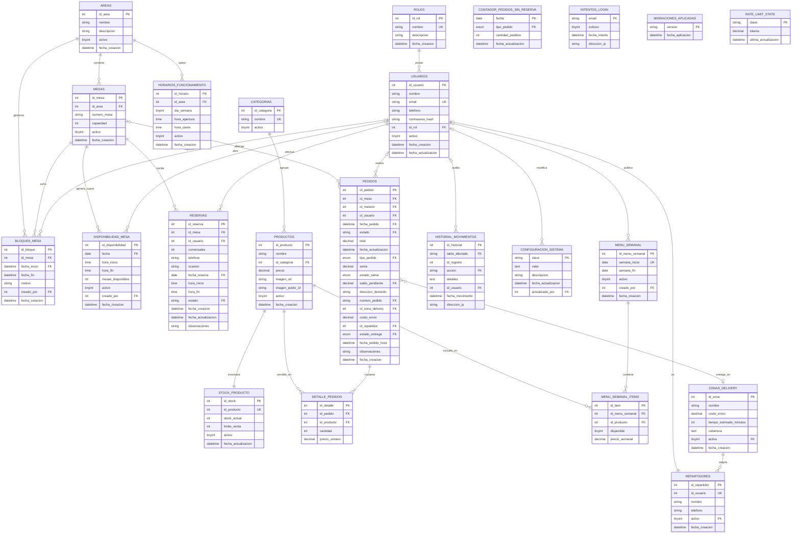

# Diagrama Entidad-Relación (DER) — Sistema de Gestión de Restaurante "Green en la Casa Blanca"

*Entregable 10 — Documento de texto equivalente (Mermaid) del diagrama `Diagrama_DER_Green.drawio`, siguiendo el modelo de referencia `entregables/referencia/DER_Panol_Barker.drawio` (notación Barker).*

> **Esquema simplificado (migración 025).** La base de datos pasó de 36 a **23 tablas**.
> Se eliminaron las funcionalidades sin interfaz (`recuperar_contrasena`, `cierre_caja`, `respaldos_bd`,
> `notificaciones`, `calificaciones_platos`, `preferencias_cliente`, `platos_favoritos`, `puntos_fidelidad`,
> `reservas_recurrentes`, `sucursales`, `permisos`/`roles_permisos` y `cupones_descuento`/`uso_cupon_cliente`)
> y se normalizó `productos.categoria` en la nueva tabla `categorias`.

## Diagrama en formato `.drawio`

Archivo editable: **`Diagrama_DER_Green.drawio`** (draw.io / diagrams.net).

Convenciones de la notación Barker empleados:

| Elemento | Representación |
|---|---|
| Entidad | Rectángulo con nombre en negrita y lista de atributos |
| Relación 1 : 1 | Flecha con `ERone` en ambos extremos |
| Relación 1 : N | Flecha con `ERone` en el lado padre y `ERmany` en el lado hijo |
| Relación N : N | Flecha con `ERmany` en ambos extremos |
| Clave primaria | Sufijo `PK` en el nombre del atributo |
| Clave foránea | Sufijo `FK` en el nombre del atributo |

## Diagrama en sintaxis Mermaid

## Diccionario de datos

El detalle campo por campo de las 23 entidades (tipo, tamaño, nulidad, valor por defecto y
descripción funcional) está en el entregable **`13_diccionario_datos.md`**.

## Resumen de entidades

| # | Entidad | PK | FK principales | Descripción |
|---|---|---|---|---|
| 1 | `areas` | id_area | — | Salones o zonas físicas del restaurante. |
| 2 | `bloques_mesa` | id_bloque | creado_por → usuarios, id_mesa → mesas | Bloqueos de una mesa en un rango de fechas. |
| 3 | `categorias` | id_categoria | — | Categorías de la carta (Entradas, Platos principales, Postres, Bebidas, Coctelería). |
| 4 | `configuracion_sistema` | clave | actualizado_por → usuarios | Parámetros del restaurante (límites de pedidos, seña, moneda). |
| 5 | `contador_pedidos_sin_reserva` | fecha | — | Contador diario de pedidos sin reserva por modalidad. |
| 6 | `detalle_pedidos` | id_detalle | id_pedido → pedidos, id_producto → productos | Líneas de cada pedido: producto, cantidad y precio unitario. |
| 7 | `disponibilidad_mesa` | id_disponibilidad | creado_por → usuarios | **Cupos de reserva**: fecha + franja horaria + mesas disponibles. |
| 8 | `historial_movimientos` | id_historial | id_usuario → usuarios | Auditoría de todos los movimientos del sistema. |
| 9 | `horarios_funcionamiento` | id_horario | id_area → areas | Horario de apertura y cierre por área y día. |
| 10 | `intentos_login` |  | — | Auditoría de intentos de ingreso (control de fuerza bruta). |
| 11 | `menu_semanal` | id_menu_semanal | creado_por → usuarios | Menú publicado por semana. |
| 12 | `menu_semanal_items` | id_item | id_menu_semanal → menu_semanal, id_producto → productos | Platos del menú semanal con precio especial. |
| 13 | `mesas` | id_mesa | id_area → areas | Mesas físicas con capacidad, dentro de un área. |
| 14 | `migraciones_aplicadas` | version | — | Registro de migraciones aplicadas a la base de datos. |
| 15 | `pedidos` | id_pedido | id_mesa → mesas, id_mesero → usuarios, id_repartidor → repartidores, id_usuario → usuarios, id_zona_delivery → zonas_delivery | Pedidos con tipo, seña, saldo y estado de entrega. |
| 16 | `productos` | id_producto | id_categoria → categorias | Catálogo de platos y bebidas con precio e imagen. |
| 17 | `rate_limit_state` | clave | — | Cubo de tokens del límite de peticiones. |
| 18 | `repartidores` | id_repartidor | id_usuario → usuarios | Personal de reparto con su usuario asociado. |
| 19 | `reservas` | id_reserva | id_mesa → mesas, id_usuario → usuarios | Reservas de mesa **confirmadas** con los datos del cliente. |
| 20 | `roles` | id_rol | — | Roles del sistema (cliente, encargado, administrador). |
| 21 | `stock_producto` | id_stock | id_producto → productos | Inventario y límite de venta por producto (1:1). |
| 22 | `usuarios` | id_usuario | id_rol → roles | Personas registradas con credenciales y rol. |
| 23 | `zonas_delivery` | id_zona | — | Zonas de entrega con costo y tiempo estimado. |
