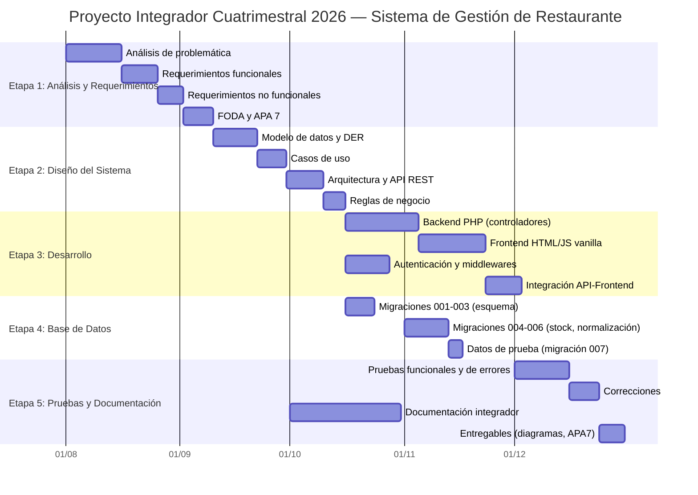

# Diagrama de Gantt — Cronograma Proyecto Integrador Cuatrimestral 2026

*Generado con Mermaid (sintaxis .md). Cronograma estimado del desarrollo del Sistema de Gestión de Restaurante "Green en la Casa Blanca".*

## Hitos del cronograma

| Fecha estimada | Hito                                                 | Entregable asociado                 |
| -------------- | ---------------------------------------------------- | ----------------------------------- |
| 2026-08-15     | Análisis de problemática concluido                   | 01_analisis_problematica.md         |
| 2026-09-02     | Requerimientos y FODA                                | 02_etapa1_requerimientos.md         |
| 2026-10-10     | Diseño completo (modelo, casos de uso, arquitectura) | 03_diseno_sistema.md                |
| 2026-11-13     | Base de datos operativa con datos de prueba          | migraciones 001→007                 |
| 2026-12-16     | Sistema funcional y probado                          | 05_sistema_funcional_pruebas.md     |
| 2026-12-31     | Entrega final del proyecto integrador                | Documento APA7 + diagramas + código |
