# Diagrama de Clases — Sistema de Gestión de Restaurante "Green en la Casa Blanca"

*Entregable 12 — Documento de texto equivalente (Mermaid) del diagrama `Diagrama_Clases_Green.drawio`, siguiendo el modelo de referencia `entregables/referencia/Diagrama_Clases_Panol.drawio`.*

> **Esquema simplificado (migración 025).** El diagrama de clases refleja las **23 entidades**
> reales de la base de datos más la capa de servicios, y ya no incluye las clases de las
> funcionalidades eliminadas (`RecuperarContrasena`, `CierreCaja`, `RespaldoBD`, `Notificacion`,
> `CalificacionPlato`, `PreferenciaCliente`, `PlatoFavorito`, `PuntosFidelidad`,
> `ReservaRecurrente`, `Sucursal`, `Permiso`, `RolPermiso`, `CuponDescuento` y `UsoCuponCliente`).

## Diagrama en formato `.drawio`

Archivo editable: **`Diagrama_Clases_Green.drawio`** (draw.io / diagrams.net).

Convenciones UML empleadas:

| Relación | Símbolo draw.io | Significado |
|---|---|---|
| Asociación | Línea continua | Relación simple entre clases. |
| Composición | Rombo relleno (◆) | La parte depende del todo (ciclo de vida asociado). |
| Agregación | Rombo hueco (◇) | Relación débil entre clases. |
| Dependencia | Línea punteada con flecha abierta | Uso puntual de una clase. |
| Atributos | Compartimento bajo el nombre de la clase | `-` privado, `+` público. |
| Métodos | Compartimento inferior | `+` público, `-` privado. |

## Diagrama en sintaxis Mermaid

```mermaid
classDiagram
    direction LR

    class Area {
        int id_area
        String nombre
        String descripcion
        boolean activo
        DateTime fecha_creacion
    }

    class BloqueMesa {
        int id_bloque
        int id_mesa
        DateTime fecha_inicio
        DateTime fecha_fin
        String motivo
        int creado_por
        DateTime fecha_creacion
        +crear(idMesa, inicio, fin, motivo): int
        +listarPorMesa(idMesa): List
        +eliminar(idBloque): boolean
    }

    class Categoria {
        int id_categoria
        String nombre
        boolean activo
    }

    class ConfiguracionSistema {
        String clave
        String valor
        String descripcion
        DateTime fecha_actualizacion
        int actualizado_por
        +obtener(clave): String
        +guardar(clave, valor): void
        +listar(): List
    }

    class ContadorPedidosSinReserva {
        Date fecha
        enum tipo_pedido
        int cantidad_pedidos
        DateTime fecha_actualizacion
        +incrementar(fecha, tipo): int
        +obtenerLimite(clave): int
    }

    class DetallePedido {
        int id_detalle
        int id_pedido
        int id_producto
        int(11) cantidad
        Decimal precio_unitario
    }

    class DisponibilidadMesa {
        int id_disponibilidad
        Date fecha
        Time hora_inicio
        Time hora_fin
        int(11) mesas_disponibles
        boolean activo
        int creado_por
        DateTime fecha_creacion
        +guardar(fecha, horaInicio, horaFin, mesas): void
        +generarLote(rangoFechas, dias, horario, mesas): int
        +listarPorFecha(fecha): List
        +eliminarRango(fechaInicio, fechaFin): int
    }

    class HistorialMovimiento {
        int id_historial
        String tabla_afectada
        int id_registro
        String accion
        String detalles
        int id_usuario
        DateTime fecha_movimiento
        String direccion_ip
        +registrar(tabla, idRegistro, accion, detalles): void
    }

    class HorarioFuncionamiento {
        int id_horario
        int id_area
        tinyint dia_semana
        Time hora_apertura
        Time hora_cierre
        boolean activo
        DateTime fecha_creacion
    }

    class IntentoLogin {
        String email
        boolean exitoso
        DateTime fecha_intento
        String direccion_ip
        +registrar(email, exitoso): void
        +contarFallosRecientes(email): int
    }

    class MenuSemanal {
        int id_menu_semanal
        Date semana_inicio
        Date semana_fin
        boolean activo
        int creado_por
        DateTime fecha_creacion
        +listar(): List
        +guardar(datos): void
    }

    class MenuSemanalItem {
        int id_item
        int id_menu_semanal
        int id_producto
        boolean disponible
        Decimal precio_semanal
    }

    class Mesa {
        int id_mesa
        int id_area
        String numero_mesa
        int(11) capacidad
        boolean activo
        DateTime fecha_creacion
        +obtenerPorId(idMesa): Mesa
    }

    class MigracionAplicada {
        String version
        DateTime fecha_aplicacion
    }

    class Pedido {
        int id_pedido
        int id_mesa
        int id_mesero
        int id_usuario
        DateTime fecha_pedido
        String estado
        Decimal total
        DateTime fecha_actualizacion
        enum tipo_pedido
        Decimal senia
        enum estado_senia
        Decimal saldo_pendiente
        String direccion_domicilio
        String numero_pedido
        int id_zona_delivery
        Decimal costo_envio
        int id_repartidor
        enum estado_entrega
        DateTime fecha_pedido_hora
        String observaciones
        DateTime fecha_creacion
        +registrar(detalles, tipo, direccion): Pedido
        +cambiarEstado(idPedido, estado): void
        +actualizarSenia(idPedido, estado): void
        +listarPropios(): List
        +listarTodos(): List
    }

    class Producto {
        int id_producto
        String nombre
        int id_categoria
        Decimal precio
        String imagen_url
        String imagen_public_id
        boolean activo
        DateTime fecha_creacion
        +listarParaCarta(categoria, busqueda): List
        +crear(datos): Producto
        +editar(id, datos): Producto
        +activar(id, activar): boolean
    }

    class RateLimitState {
        String clave
        Decimal tokens
        DateTime ultima_actualizacion
        +consumir(clave, coste): boolean
    }

    class Repartidor {
        int id_repartidor
        int id_usuario
        String nombre
        String telefono
        boolean activo
        DateTime fecha_creacion
        +crear(datos): int
        +listar(): List
    }

    class Reserva {
        int id_reserva
        int id_mesa
        int id_usuario
        int comensales
        String telefono
        String ocasion
        Date fecha_reserva
        Time hora_inicio
        Time hora_fin
        String estado
        DateTime fecha_creacion
        DateTime fecha_actualizacion
        String observaciones
        +crearReserva(mesa, usuario, fecha, horaInicio, horaFin): int
        +cancelar(idReserva): boolean
        +cambiarEstado(idReserva, estado): boolean
        +listarPorUsuario(idUsuario): List
        +listarTodas(): List
    }

    class Rol {
        int id_rol
        String nombre
        String descripcion
        DateTime fecha_creacion
    }

    class StockProducto {
        int id_stock
        int id_producto
        int(11) stock_actual
        int(11) limite_venta
        boolean activo
        DateTime fecha_actualizacion
        +guardarStock(datos): void
        +listar(): List
        +listarStockBajo(umbral): List
    }

    class Usuario {
        int id_usuario
        String nombre
        String email
        String telefono
        String contrasena_hash
        int id_rol
        boolean activo
        DateTime fecha_creacion
        DateTime fecha_actualizacion
        +autenticar(email, contrasena, ip): Usuario
        +registrar(nombre, email, contrasena, rol): Usuario
        +iniciarSesion(datos): void
        +cerrarSesion(): void
        +estaAutenticado(): boolean
        +esAdministrador(): boolean
    }

    class ZonaDelivery {
        int id_zona
        String nombre
        Decimal costo_envio
        int tiempo_estimado_minutos
        String cobertura
        boolean activa
        DateTime fecha_creacion
        +crear(datos): int
        +actualizar(idZona, campos): boolean
        +listar(): List
    }

    %% ================= Capa de servicios =================
    class ServicioDeAutenticacion {
        -usuarioDao: UsuarioDao
        -intentosDao: IntentosLoginDao
        +autenticar(email, contrasena, ip): Usuario
        +registrar(nombre, email, contrasena, rol): Usuario
        +iniciarSesion(datos): void
        +cerrarSesion(): void
        +estaAutenticado(): boolean
        +esAdministrador(): boolean
    }

    class ServicioDeReservas {
        -reservaDao: ReservaDao
        -validador: ValidadorDeReserva
        +crearReserva(mesa, usuario, fecha, horaInicio, horaFin): int
        +obtenerReserva(id): Reserva
        +listarReservasUsuario(id): List
        +listarTodasLasReservas(): List
        +cancelarReserva(id, usuario): boolean
        +cambiarEstadoReserva(id, estado): boolean
    }

    class ValidadorDeReserva {
        -reservaDao: ReservaDao
        -mesaDao: MesaDao
        +validarCreacion(mesa, usuario, fecha, horaInicio, horaFin): void
        +validarCancelacion(reserva): void
        -validarFormatoFecha(fecha): void
        -validarFormatoHora(hora): void
        -validarNoPasado(fecha, hora): void
        -validarAnticipacionMaxima(fecha): void
        -validarHorarioFuncionamiento(mesa, fecha, horaInicio, horaFin): void
        -validarSinSolapamiento(mesa, fecha, horaInicio, horaFin): void
    }

    class ServicioDeProductos {
        -productoDao: ProductoDao
        -cloudinary: ServicioDeCloudinary
        +listarParaCarta(categoria, busqueda): List
        +crear(datos): Producto
        +editar(id, datos): Producto
        +activar(id, activar): boolean
    }

    class ServicioDeMesas {
        -areaDao: AreaDao
        -mesaDao: MesaDao
        +listarAreas(): List
        +obtenerArea(id): Area
        +listarMesas(idArea): List
        +listarTodasMesas(): List
        +obtenerMesa(id): Mesa
    }

    class ServicioDeDisponibilidad {
        -disponibilidadDao: DisponibilidadMesaDao
        +listarDisponibilidad(fecha): List
        +generarLote(rango, dias, horario, mesas): int
        +eliminarRango(inicio, fin): int
    }

    class ServicioDePedidos {
        -pedidoDao: PedidoDao
        -productoDao: ProductoDao
        -mesaDao: MesaDao
        +registrar(datos, usuario): Pedido
        +cambiarEstado(id, estado): boolean
        +actualizarSenia(id, estado): boolean
        +listarPorUsuario(id): List
    }

    class ServicioDeBloques {
        -bloqueDao: BloqueMesaDao
        +listarPorMesa(idMesa): List
        +crearBloque(datos): int
        +desactivarBloque(id): boolean
    }

    %% ================= Relaciones =================
    Rol "1" -- "*" Usuario : posee
    Area "1" *-- "*" Mesa : contiene
    Area "1" *-- "*" HorarioFuncionamiento : opera
    Area "1" -- "*" BloqueMesa : gestiona
    Mesa "1" *-- "*" DisponibilidadMesa : genera_cupos
    Mesa "1" -- "*" Reserva : recibe
    Mesa "1" *-- "*" BloqueMesa : sufre
    Mesa "0..1" -- "*" Pedido : alberga
    Usuario "0..1" -- "*" DisponibilidadMesa : abre
    Usuario "0..1" -- "*" BloqueMesa : registra
    Usuario "1" -- "*" Reserva : efectua
    Usuario "0..1" -- "*" Pedido : realiza
    Usuario "0..1" -- "*" MenuSemanal : publica
    Usuario "0..1" -- "*" HistorialMovimiento : audita
    Usuario "0..1" -- "*" ConfiguracionSistema : modifica
    Usuario "0..1" -- "1" Repartidor : es
    Categoria "1" o-- "*" Producto : agrupa
    Producto "1" *-- "1" StockProducto : inventaria
    Producto "1" -- "*" DetallePedido : vendido_en
    Producto "1" -- "*" MenuSemanalItem : incluido_en
    Pedido "1" *-- "1..*" DetallePedido : contiene
    Pedido "0..*" -- "0..1" ZonaDelivery : entrega_en
    ZonaDelivery "1" o-- "*" Repartidor : asigna
    MenuSemanal "1" *-- "*" MenuSemanalItem : contiene
    Usuario "1" -- "*" IntentoLogin : genera
    ServicioDeAutenticacion ..> Usuario : autentica
    ServicioDeReservas ..> Reserva : gestiona
    ServicioDeReservas ..> ValidadorDeReserva : valida_con
    ValidadorDeReserva ..> Reserva : valida
    ServicioDeProductos ..> Producto : administra
    ServicioDeMesas ..> Mesa : consulta
    ServicioDeDisponibilidad ..> DisponibilidadMesa : genera_cupos
    ServicioDePedidos ..> Pedido : registra
    ServicioDeBloques ..> BloqueMesa : gestiona
```

## Descripción de las clases

Las clases de entidad corresponden una a una con las tablas del DER (`10_diagrama_der.md`).

## Capa de servicios

| Servicio | Responsabilidad |
|---|---|
| `ServicioDeAutenticacion` | Verificación de credenciales, emisión de sesión y control de intentos fallidos. |
| `ServicioDeReservas` | Orquestación de la reserva: valida, descuenta cupo y persiste. |
| `ValidadorDeReserva` | Reglas de negocio: formato de fecha y hora, anticipación máxima, horario de funcionamiento y solapamiento. |
| `ServicioDeProductos` | Alta, edición y activación de platos, con integración de imágenes. |
| `ServicioDeMesas` | Consulta de áreas y mesas, incluida la lista global sin filtro de área. |
| `ServicioDeDisponibilidad` | Generación masiva y eliminación de cupos por rango de fechas. |
| `ServicioDePedidos` | Registro del pedido, cálculo de seña y saldo, y control de stock. |
| `ServicioDeBloques` | Alta, listado y desactivación de bloqueos de mesa. |

## Trazabilidad

- Las clases `Rol`, `Usuario`, `Area`, `Mesa`, `HorarioFuncionamiento`, `DisponibilidadMesa`, `BloqueMesa`, `Reserva`, `Categoria`, `Producto`, `StockProducto`, `Pedido`, `DetallePedido`, `MenuSemanal`, `MenuSemanalItem`, `ZonaDelivery`, `Repartidor`, `ConfiguracionSistema`, `ContadorPedidosSinReserva`, `HistorialMovimiento`, `IntentoLogin`, `RateLimitState` y `MigracionAplicada` corresponden uno a uno con las entidades del DER (`10_diagrama_der.md`) y con las tablas documentadas en `13_diccionario_datos.md`.
- Los casos de uso CU1 a CU34 (`09_diagrama_caso_uso.md`) se corresponden con los métodos de los servicios y controladores.
